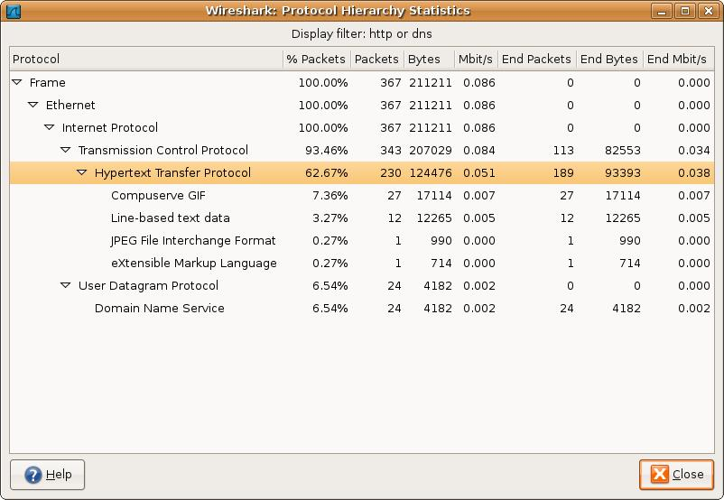
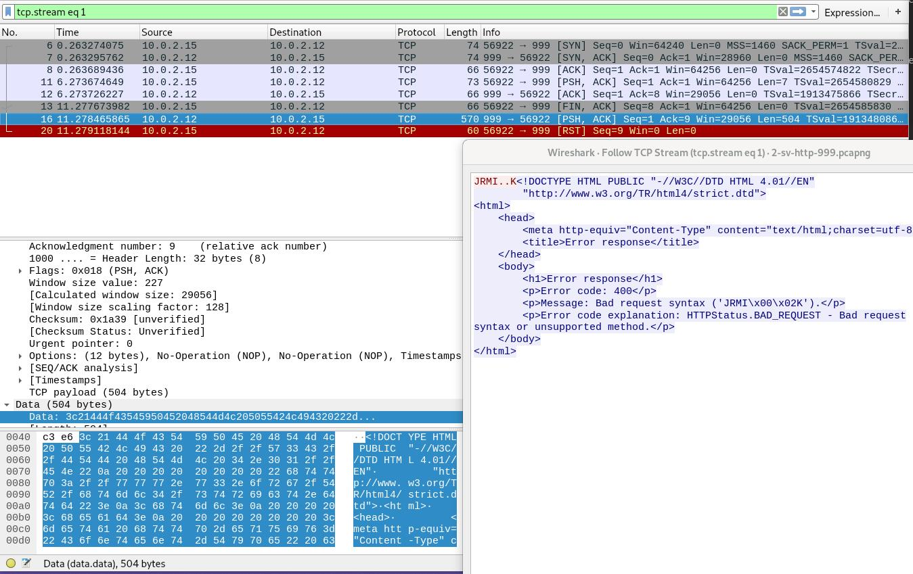

# 03 - Web Attack Detection & HTTP Anomalies

## Executive Summary

This investigation examines three distinct HTTP traffic-analysis scenarios using Wireshark and packet captures from Hack The Box Academy's Intermediate Network Traffic Analysis module: HTTP GET enumeration/fuzzing, malformed HTTP requests associated with header manipulation, and a suspicious request containing a cookie value in a URL parameter. 

The analysis combines protocol filtering, response-code inspection, and TCP stream reconstruction to identify observable network behaviors and their defensive relevance. 

The three captures represent network investigation scenarios, not a single continuous intrusion.

## Investigation Objectives

- Identify and quantify HTTP GET requests in a web-enumeration capture.
  
- Detect HTTP `400 Bad Request` responses associated with malformed request traffic.
  
- Inspect HTTP streams for cookie data embedded in requests to another endpoint.
  
- Distinguish observable packet evidence from attack hypotheses.
  
- Develop actionable detection and triage guidance for SOC analysts.
  
- Map relevant behaviors to MITRE ATT&CK where justified.

## Background

### HTTP Service Enumeration and Fuzzing

HTTP enumeration involves systematically requesting URLs, directories, endpoints, or parameters to discover exposed functionality. 

Fuzzing varies inputs to identify valid resources or unexpected application behavior. 

Large or patterned bursts of GET requests can warrant review, but **GET volume alone does not establish malicious intent**.

### HTTP Header Manipulation and CRLF

Malformed HTTP headers, Host-header changes, and carriage-return/line-feed (CRLF) manipulation may be used to test parsing behavior or attempt injection.

An HTTP `400 Bad Request` response indicates the server rejected a request as malformed; the response code alone does not prove a successful exploit.

### XSS and Cookie Exfiltration

Cross-site scripting (XSS) can allow attacker-controlled script to execute in a victim's browser. 

If readable cookies are accessed by malicious script, they may be transmitted to an attacker-controlled destination. 

A captured request carrying a `cookie` query parameter is evidence of data being sent in the URL, but the packet alone does not independently establish the browser-side XSS mechanism.

### MITRE ATT&CK Mapping

| Technique | ATT&CK ID | Relevance |
|---|---|---|
| Active Scanning: Vulnerability Scanning | T1595.002 | Possible interpretation of systematic web probing; not confirmed solely by GET counts |
| Exploit Public-Facing Application | T1190 | Potential goal of injection attempts; successful exploitation not demonstrated |
| Exfiltration Over Web Service | T1567 | Possible exfiltration pattern; attribution and technique applicability require further evidence |

*Mappings are contextual hypotheses, not confirmed classifications for every packet in these captures.*

## Data Sources and Tools

| Source / Tool | Purpose |
|---|---|
| `basic_fuzzing.pcapng` | HTTP GET request enumeration |
| `CRLF_and_host_header_manipulation.pcapng` | HTTP response-code analysis |
| `XSS_Simple.pcapng` | HTTP request and stream inspection |
| Wireshark | Display filtering, protocol statistics, packet and TCP stream analysis |
| Hack The Box Academy | Training-lab source of the captures |

The original PCAPs are **not redistributed** in this repository. Screenshots and documented observations are included for readers without access to the training resources.

## Investigation Scope

The scope is limited to the three provided PCAP scenarios and the evidence visible in the supplied Wireshark screenshots and lab notes. 

No server logs, endpoint telemetry, complete exploitation chain, or independent packet re-analysis were supplied. 
Conclusions are correspondingly limited.

## Investigation Methodology

1. Open each capture in Wireshark.
   
2. Apply a protocol-specific display filter to isolate the relevant requests or responses.
   
3. Confirm displayed packet counts using the status bar or Protocol Hierarchy statistics.
   
4. For the suspected cookie transfer, follow the relevant TCP stream and inspect the HTTP request line and response.

5. Record findings, distinguish confirmed observations from potential attack behavior, and identify detection opportunities.

## Investigation Artifacts

The investigation used the following Wireshark commands to access the extracted network captures:

```bash
wireshark Intermediate_Network_Traffic_Analysis/basic_fuzzing.pcapng
wireshark Intermediate_Network_Traffic_Analysis/CRLF_and_host_header_manipulation.pcapng
wireshark Intermediate_Network_Traffic_Analysis/XSS_Simple.pcapng
```

These commands assume the files have already been obtained and extracted into the indicated directory. 

## Investigation #1 — HTTP/HTTPS Service Enumeration

### Purpose

Analyze HTTP GET request activity in **basic_fuzzing.pcapng** to identify potential enumeration or fuzzing behavior and quantify the observed traffic.

### Wireshark Display Filter

The initial analysis used the following filter to isolate HTTP GET requests:

```wireshark
http.request.method == "GET"
```

To **explicitly enforce destination port 80**, use:

```wireshark
http.request.method == "GET" && tcp.dstport == 80
```

The provided screenshot verifies the first filter and its count; it does **not** independently verify that all 204 displayed requests target destination port 80.

### Results

| Field | Observed Value |
|---|---|
| Capture | `basic_fuzzing.pcapng` |
| Total captured packets | 2,040 |
| Packets displayed by GET filter | **204** |
| Share of capture | **10.0%** |
| Explicit port-80 validation | Not independently shown in supplied screenshot |

### Evidence

### Figure 7 - HTTP GET Analysis 



### Interpretation

The filtered view identifies 204 HTTP GET requests. 

Given the training scenario, this may represent enumeration or fuzzing activity, but stronger attribution would require request-path distribution, timing, source addresses, status-code patterns, and user-agent analysis.

## Investigation #2 — Strange HTTP Headers

### Purpose

Investigate malformed HTTP traffic associated with potential CRLF and Host-header manipulation by examining HTTP 400 Bad Request responses.

### Wireshark Display Filter

```wireshark
http.response.code == 400
```

### Results

| Field | Observed Value |
|---|---|
| Capture | `CRLF_and_host_header_manipulation.pcapng` |
| HTTP 400 responses | **7** |
| Visible communicating hosts | `192.168.10.7` and `192.168.10.5` |
| Meaning of HTTP 400 | Server rejected the request as malformed |

### Evidence

### Figure 8 - HTTP 400 Responses 



### Interpretation

Seven HTTP 400 responses were identified. 

This is consistent with rejected malformed requests in the lab scenario, but confirmation of a particular CRLF or Host-header payload requires examining the corresponding requests, not just the responses.

## Investigation #3 — XSS & Cookie Exfiltration Indicators

### Purpose

Investigate potential cookie exposure in **XSS_Simple.pcapng** by reconstructing HTTP communication and identifying session-related data transmitted through URL parameters.

### Investigation Steps

1. Open `XSS_Simple.pcapng` in Wireshark.
   
2. Select the relevant initial HTTP packet.
   
3. Right-click and choose **Follow → TCP Stream** (or **Follow → HTTP Stream** where available).
   
4. Inspect the HTTP request line for the `cookie=` parameter.
   
5. Review the request destination and response, and record whether the data transfer is visible.
   
### Evidence

### Figure 9 - Cookie Exposure Analysis


### Results

| Field | Observed Value |
|---|---|
| Capture | `XSS_Simple.pcapng` |
| Method | HTTP GET |
| Destination host shown | `192.168.10.5` |
| Suspicious artifact | `cookie=` query parameter in the URL |
| Server response shown | `404 Not Found` |
| Cookie value | Present in supplied evidence; intentionally redacted in this public-facing report |

The URL carries cookie-like data in a GET query string. 

The observed `404` response does **not** negate the fact that the request was sent, but it also does not establish that a broader exfiltration objective succeeded. 

The precise cookie string is withheld to avoid unnecessarily publishing potentially sensitive session material.

## Investigation Findings

| Investigation | Confirmed Observation | Security Interpretation |
|---|---|---|
| HTTP enumeration | 204 packets match HTTP GET filter | Investigate for scripted enumeration or fuzzing |
| Header anomalies | 7 HTTP 400 responses | Review corresponding malformed requests and header fields |
| Cookie transfer | GET URL contains `cookie=` parameter | Possible cookie leakage/exfiltration indicator; XSS execution not directly proven |

## Detection Logic

### Indicator #1 — HTTP Request Bursts and Enumeration

- Monitor unusually high GET request rates per client and destination.
  
- Correlate request-path diversity, repeated 404/403 responses, sequential identifiers, and uncommon user agents.
  
- Establish a baseline to avoid flagging normal crawlers, health checks, or load tests.

Example Wireshark filter:

```wireshark
http.request.method == "GET" && tcp.dstport == 80
```

### Indicator #2 — Malformed HTTP Requests

- Investigate clusters of `400` responses from the same source.
  
- Correlate server access/error logs with unusual `Host` headers, encoded CRLF sequences, and parsing errors.
  
- Avoid treating all `400` responses as hostile; client errors and misconfiguration are common.

```wireshark
http.response.code == 400
```

### Indicator #3 — Cookie Values in URL Parameters

- Look for requests that place authentication or session material in URL query parameters.
  
- Correlate destination, `Referer`, browser telemetry, and application logs.
  
- Protect session cookies using `HttpOnly`, `Secure`, and appropriate `SameSite` attributes; prevent XSS with context-aware output encoding and input handling.

```wireshark
http.request && http.request.uri contains "cookie="
```

*This is a hunting filter, not a signature proving malicious XSS.*

**Detection engineering consideration**: Correlating HTTP request patterns, response-code anomalies, and suspicious URL parameters with web server logs, WAF telemetry, and endpoint activity can improve detection confidence and reduce false positives.

## MITRE ATT&CK Mapping — Investigative Context

| Tactic | Technique | ATT&CK ID | Confidence / Limitation |
|---|---|---|---|
| Reconnaissance | Active Scanning: Vulnerability Scanning | T1595.002 | Possible web-probing behavior; request counts alone insufficient |
| Initial Access | Exploit Public-Facing Application | T1190 | Relevant to attempted web exploitation; no confirmed successful compromise |
| Exfiltration | Exfiltration Over Web Service | T1567 | Potentially related to web-based data transfer; specific technique not established |

## IOC / Observable Summary

| Type | Value / Pattern | Interpretation |
|---|---|---|
| HTTP method | `GET` | 204 filtered requests in enumeration capture |
| HTTP response | `400 Bad Request` | 7 responses in header-manipulation capture |
| HTTP request parameter | `cookie=` | Suspicious placement of cookie material in a URL |
| Destination host in XSS capture | `192.168.10.5` | Lab-only private IP; not a globally actionable IOC |
| Tooling | Wireshark | Packet-level inspection and stream reconstruction |

The above are primarily **investigation observables**, not inherently malicious indicators of compromise.

## Lessons Learned

| Lesson | Description |
|---|---|
| Filter precision | Add `tcp.dstport == 80` when a specific investigation explicitly requires port 80; don't infer it from GET alone. |
| Context matters | GET requests and HTTP 400 responses are common; patterns and corroboration drive confidence. |
| Stream reconstruction | Following TCP streams can reveal data exposed in plaintext HTTP requests. |
| XSS attribution | A suspicious request does not by itself prove the original injection or browser execution step. |
| Defensible reporting | Separate observed evidence, hypotheses, and recommended follow-up checks. |

## Conclusion

Across three independent network traffic captures, the investigation identified **204 HTTP GET requests**, **7 HTTP 400 responses**, and an HTTP request carrying cookie data in a URL parameter. 

Wireshark display filters, protocol statistics, and TCP stream reconstruction provided the primary investigative evidence. 

These findings demonstrate practical web-traffic triage while highlighting the importance of verifying destination ports, inspecting request payloads, and avoiding overconfident conclusions about exploitation or exfiltration from limited packet evidence.

