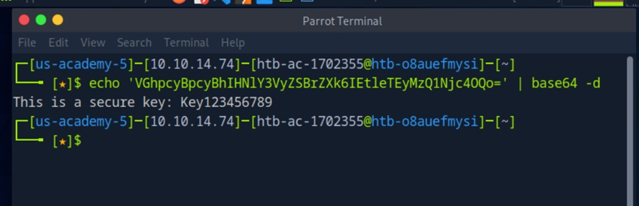
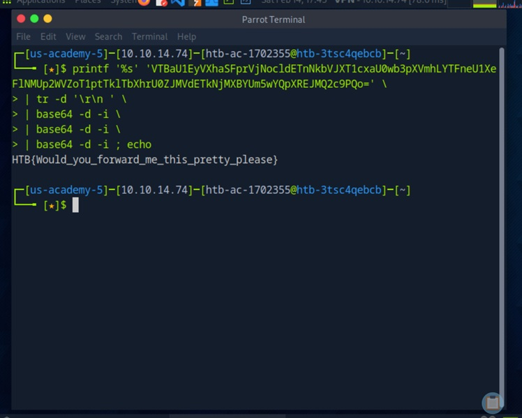
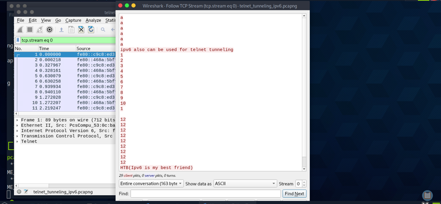

# 04 - Covert Channels & Tunneling Detection

## Executive Summary

This investigation combines three Hack The Box Intermediate Network Traffic Analysis training scenarios: decoding a Base64-encoded string, decoding a triple-Base64-encoded string, and examining a Telnet conversation carried over IPv6. 

The investigations demonstrate payload decoding and TCP stream reconstruction—useful techniques for investigating potentially concealed communications. 

The available evidence confirms readable decoded content and a plaintext Telnet stream, but **does not independently establish ICMP tunneling, DNS tunneling, data exfiltration, or an unauthorized intrusion**.

## Investigation Objectives

- Decode Base64-encoded content and interpret the resulting plaintext.
  
- Demonstrate recursive decoding of multiply encoded data.
  
- Examine Telnet traffic over IPv6 using Wireshark.
  
- Reconstruct a TCP conversation and identify embedded text.
  
- Distinguish confirmed observations from possible covert-channel indicators.
  
- Develop practical detection and triage recommendations.

## Background

### Covert Channels and Tunneling

Tunneling carries one form of traffic or data within another protocol.

Covert channels attempt to conceal communications or circumvent expected controls. 

Unusual payloads in DNS, ICMP, or application protocols may warrant investigation, but protocol use or encoded content alone does not establish malicious intent.

### Base64 Encoding

Base64 is a reversible text encoding, **not encryption**. 

Repeated encoding can obscure content from casual inspection but offers no cryptographic protection.

Analysts can decode suspicious strings to assess their meaning and origin.

### Telnet over IPv6

Telnet is a plaintext remote-terminal protocol. 

If the traffic is captured in readable form, Wireshark can reconstruct application data using **Follow TCP Stream**, even when the underlying IP traffic uses IPv6. 

Telnet traffic is not automatically a tunnel or an attack.

## MITRE ATT&CK Mapping

| Technique | ATT&CK ID | Relevance / Evidence Limitation |
|---|---|---|
| Obfuscated Files or Information | T1027 | Conceptually relevant to encoded content; the lab does not prove adversarial obfuscation. |
| Protocol Tunneling | T1572 | A hypothesis for covert-channel investigations, **not confirmed** by these artifacts. |
| Non-Application Layer Protocol | T1095 | Relevant when investigating ICMP-based command-and-control; **no ICMP capture is analyzed here**. |
| Application Layer Protocol: DNS | T1071.004 | Relevant to DNS-based covert communications; **no DNS capture is analyzed here**. |

> ATT&CK entries are investigative context, not assertions that these techniques were observed.

## Data Sources & Tools

| Source / Tool | Purpose |
|---|---|
| Hack The Box Academy training material | Source of supplied encoded strings and lab capture |
| Parrot OS terminal | Base64 decoding using standard shell tools |
| `base64`, `printf`, `tr` | Decode encoded text and normalize whitespace |
| Wireshark | Inspect packets and reconstruct TCP streams |
| `telnet_tunneling_ipv6.pcapng` | IPv6/Telnet packet capture used for stream analysis |

## Investigation Scope

Three investigation artifacts are included. 

The first two are **string-decoding analyses**, not packet-capture investigations. 

The third analyzes the Telnet conversation in `telnet_tunneling_ipv6.pcapng`. 

This report is self-contained and includes screenshots and the analytical steps, but it does not redistribute the original HTB capture.

## Investigation Methodology

1. Decode the supplied Base64 text and review the plaintext.
   
2. Apply three successive Base64 decoding passes to the multiply encoded text.
   
3. Open the supplied IPv6 Telnet PCAP in Wireshark.
   
4. Select a Telnet/TCP packet and reconstruct the stream.
   
5. Record the observed content and assess whether it proves tunneling or only visible application traffic.
   
6. Document detection opportunities and investigation limitations.

## Investigation Artifact #1 — ICMP Tunneling Section: Base64 Decoding

### Purpose

Analyze Base64-encoded content using command-line decoding techniques to recover readable plaintext and assess its potential security relevance. This analysis focuses on payload decoding rather than direct ICMP packet inspection.

### Command

```bash
echo 'VGhpcyBpcyBhIHNlY3VyZSBrZXk6IEtleTEyMzQ1Njc4OQo=' | base64 -d
```

### Result

```text
This is a secure key: Key123456789
```

### Figure 10 - Base64 Payload Decoding



### Finding

The string decodes into a readable message containing an example key. 

This confirms successful decoding, **not** that the key was stolen, transmitted via ICMP, or used in an intrusion. 

Treat strings found in real network payloads as sensitive until reviewed.

## Investigation Artifact #2 — Peculiar DNS Traffic: Triple Base64 Decoding

### Purpose

Investigate layered Base64 encoding by applying multiple decoding operations to recover the underlying plaintext. This analysis demonstrates how repeated encoding can obscure readable information without providing cryptographic protection. No DNS packet evidence is available to establish DNS tunneling.

### Decoding Method

The analysis used a pipeline of three successive decoding passes. A generic, reproducible pattern is:

```bash
printf '%s' '<BASE64_STRING_FROM_LAB>' \
  | tr -d '\r\n ' \
  | base64 -d -i \
  | base64 -d -i \
  | base64 -d -i
```

The placeholder must be replaced with the encoded string supplied in the lab; the screenshot records the original execution.

### Result

```text
HTB{Would_you_forward_me_this_pretty_please}
```
Three successive Base64 decoding operations recovered a readable HTB training artifact, demonstrating successful interpretation of multiply encoded content.

### Figure 11 - Triple Base64 Decoding



### Finding

Three successive decoding passes exposed an HTB training flag. 

Multiple layers of encoding can make inspection less direct, but **encoding depth alone is not evidence of DNS tunneling**.

DNS tunneling would require DNS-specific evidence, such as unusual query names, volume, timing, or encoded labels.

## Investigation Artifact #3 — Strange Telnet & UDP Connections: Telnet over IPv6

### Purpose

Analyze Telnet communication over IPv6 using Wireshark TCP stream reconstruction to identify readable application-layer content and assess whether the observed traffic provides evidence of tunneling or anomalous communication.

The available capture evidence demonstrates plaintext Telnet stream inspection; UDP tunneling is not established.

### Capture

`Intermediate_Network_Traffic_Analysis/telnet_tunneling_ipv6.pcapng`

### Open the Capture

```bash
wireshark Intermediate_Network_Traffic_Analysis/telnet_tunneling_ipv6.pcapng
```

### Wireshark Methodology

1. Locate a packet identified as Telnet in the packet list.
   
2. Right-click the packet and choose **Follow → TCP Stream**.
   
3. Review the reconstructed plaintext conversation in the stream window.
   
4. Record the relevant string and distinguish it from other traffic.

Optional display filters for targeted inspection:

```wireshark
telnet
```

```wireshark
tcp.stream == 0
```

The second filter targets stream 0, as shown in the supplied screenshot; other captures may use different stream indices.

### Figure 12 - IPv6 Telnet Stream Analysis



### Observed Result

The screenshot shows the plaintext message:

```text
ipv6 also can be used for telnet tunneling
```
The reconstructed stream also contained an HTB training artifact embedded in the plaintext Telnet conversation. Its presence demonstrates successful stream reconstruction and application-layer content inspection, rather than confirmed covert tunneling.

### Finding

The capture demonstrates that an IPv6 Telnet conversation can be reconstructed and its application data inspected in plaintext.

The visible string references tunneling, but **that text does not by itself prove a covert tunnel, exfiltration, or compromise**.

## Investigation Findings

| Artifact | Confirmed Observation | What It Does Not Prove |
|---|---|---|
| Single Base64 string | Decoded to `This is a secure key: Key123456789` | ICMP tunneling or key theft |
| Triple Base64 string | Recovered a readable training artifact after three Base64 decoding passes. Decoded to `HTB{Would_you_forward_me_this_pretty_please}` | DNS tunneling or data exfiltration |
| IPv6 Telnet PCAP | Readable TCP stream with Telnet text and a training flag | Unauthorized access or covert tunneling |

## Detection Logic

### Indicator #1: Encoded Payloads

Investigate unusually long or repeated encoded strings found in network content, process command lines, or application logs. 

Validate decoding results and correlate them with destinations, timing, process activity, and user context; Base64 is also widely used legitimately.

### Indicator #2: Potential DNS Tunneling

For future DNS PCAP analysis, investigate unusually long or high-entropy subdomain labels, excessive unique queries to a domain, irregular TXT queries, and repeated outbound query bursts.

Correlate with endpoint and DNS resolver telemetry before making an attribution.

### Indicator #3: Potential ICMP Tunneling

For future ICMP PCAP analysis, review payload sizes, unusually regular echo request/reply timing, repeated payload structures, and atypical external peers. 

These checks were **not performed against an ICMP PCAP in this chapter**.

### Indicator #4: Telnet Exposure

Monitor TCP/23 and Telnet sessions, especially across untrusted boundaries.

Where possible, replace Telnet with SSH and investigate any unexpected plaintext authentication or commands.

**Detection engineering consideration**: Encoded payloads should be assessed alongside protocol behavior, destination characteristics, communication frequency, and endpoint telemetry. Encoding alone is insufficient to establish malicious activity or covert-channel usage.

## IOC / Observable Summary

| Type | Value / Pattern | Classification |
|---|---|---|
| Protocol | Telnet over IPv6 | Observed |
| Capture | `telnet_tunneling_ipv6.pcapng` | Lab artifact |
| Stream | `tcp.stream == 0` | Screenshot-based inspection filter |
| Decoded text | `This is a secure key: Key123456789` | Training example; not a confirmed compromised secret |
| Encoded payload pattern | Multiple Base64 layers | General investigative lead |
| DNS / ICMP tunnel indicators | Not established | Requires separate traffic evidence |

## Lessons Learned

| Lesson | Description |
|---|---|
| Encoding vs. Encryption | Base64 is reversible and does not protect confidentiality. |
| Recursive Decoding | Multiple decoding passes may be required to interpret layered encodings. |
| Stream Reconstruction | Wireshark can reconstruct plaintext Telnet communications over IPv6. |
| Evidence Discipline | A training flag or encoded string does not independently prove tunneling. |
| Detection Context | Reliable conclusions require protocol-specific indicators and corroborating telemetry. |

## Conclusion

This chapter demonstrates practical payload-decoding and network stream-inspection skills relevant to SOC threat hunting. 

Two Base64 decoding investgations recovered readable strings, while Wireshark reconstruction of an IPv6 Telnet session exposed plaintext application data. 

These findings illustrate techniques analysts may use when investigating suspicious or potentially concealed communications; **they do not establish DNS tunneling, ICMP tunneling, or a successful covert-channel attack in the supplied evidence**. 

Further protocol-specific packet analysis would be needed to substantiate those claims.

