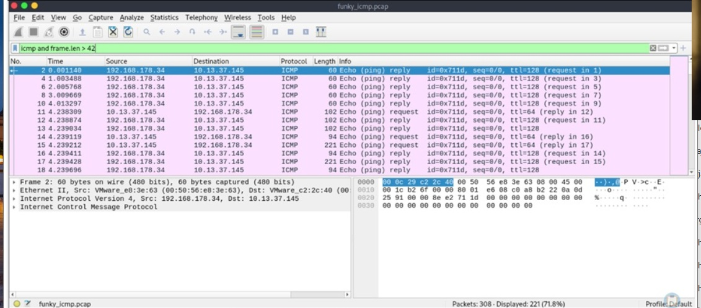

# 05 - SOC Network Anomaly Investigation: DNS & ICMP Tunneling

## Executive Summary

This SOC network investigation examines two packet captures, `funky_dns.pcap` and `funky_icmp.pcap`, from a Hack The Box Academy skills assessment. 

The analysis classifies the suspicious activity as **DNS tunneling** and **ICMP tunneling**, respectively. 

The DNS conclusion is based on the analyst's recorded observations of unusual domain-related responses and suspected command-and-control (C2) behavior; the original DNS capture and supporting screenshots were not provided for independent validation. 

The ICMP investigation includes a Wireshark screenshot showing filtered ICMP traffic and analyst notes describing HTTP-like content and unusually large ICMP frames. 

Findings are distinguished from unverified inferences throughout.

## Investigation Objectives

- Identify abnormal DNS and ICMP traffic patterns.
  
- Differentiate tunneling indicators from flooding and amplification behavior.
  
- Document reproducible Wireshark inspection steps and available evidence.
  
- Assess potential command-and-control and data-transfer implications.
  
- Recommend SOC detection and validation steps.

## Background

### DNS Tunneling

DNS tunneling encodes data or commands into DNS queries or responses, potentially allowing covert communications through infrastructure that permits DNS traffic.

Suspicious indicators can include unusual query names, long or high-entropy labels, frequent requests, unexpected record types, and repeated interactions with uncommon domains.

None is conclusive alone.

### ICMP Tunneling
ICMP tunneling embeds information in ICMP payloads, commonly echo requests and replies, to transport content that is not typical diagnostic ping traffic. 

Abnormally large or structured payloads and repeated bidirectional exchanges can warrant investigation. 

ICMP does not require a fixed 42-byte frame length: legitimate payload sizes vary.

### MITRE ATT&CK Mapping

| Tactic | Technique | ID | Relevance |
|---|---|---|---|
| Command and Control | Application Layer Protocol: DNS | T1071.004 | Potential C2 over DNS |
| Command and Control | Non-Application Layer Protocol | T1095 | Potential C2 over ICMP |
| Command and Control | Protocol Tunneling | T1572 | Candidate tunneling behavior; requires further validation |

*These are analytic mappings, not proof that the complete techniques occurred.*

## Data Sources & Tools

| Source / Tool | Purpose |
|---|---|
| `funky_dns.pcap` | DNS traffic investigation |
| `funky_icmp.pcap` | ICMP traffic investigation |
| Wireshark | Packet inspection, display filters, stream and payload review |
| Parrot OS terminal | Opening packet captures |
| HTB Academy skills assessment | Training context |

## Investigation Scope

The assessment covers two supplied packet captures. 

Only one ICMP screenshot was provided for this write-up; DNS-specific packet-level evidence and the PCAP files were not attached. 

Results should therefore be understood as a documented training-based network investigation based on the analyst's recorded findings, rather than an independent reanalysis of the raw captures.

## Investigation Methodology

1. Obtain the packet capture resources through authorized HTB Academy access and extract them locally.
   
2. Open each capture in Wireshark.
   
3. Isolate the relevant protocol and review source/destination patterns, frequency, packet sizes, and payload content.
   
4. Compare observed activity with normal protocol behavior.
   
5. Classify likely attack technique and document alternative explanations or remaining uncertainties.

### Optional local workflow

```bash
unzip pcap_files.zip
wireshark Intermediate_Network_Traffic_Analysis/funky_dns.pcap
wireshark Intermediate_Network_Traffic_Analysis/funky_icmp.pcap
```

The original HTB resource files are not redistributed here.

## Investigation Artifact #1 — DNS Traffic Analysis

### Purpose

Investigate anomalous DNS traffic patterns to distinguish potential DNS tunneling activity from DNS flooding, amplification, and legitimate name-resolution behavior.

### Wireshark Filters

```wireshark
dns
```

For further analysis, inspect DNS query names, responses, lengths, timing, and repeated domains; where supported, useful filters include:

```wireshark
dns.flags.response == 0
dns.flags.response == 1
```

### Recorded Observations

The analyst's notes describe DNS responses associated with suspicious or bogus domains and behavior interpreted as C2-style agent communication or tasking. 

The notes classify the capture as **DNS Tunneling**. 

The underlying domain names, encoded payloads, DNS transaction counts, and timing patterns were not supplied; therefore the C2 interpretation cannot be independently established from the material provided.

### Finding

| Field | Value |
|---|---|
| Capture | `funky_dns.pcap` |
| Lab classification | DNS Tunneling |
| Confidence from supplied evidence | Limited; analyst notes only |
| Additional evidence needed | DNS query/response samples, timing, record types, payload inspection |

**Analytical assessment**: The recorded observations suggest possible DNS-based covert communication. However, confirming DNS tunneling would require inspecting query structures, response patterns, payload characteristics, and communication frequency in the original capture.

## Investigation Artifact #2 — ICMP Traffic Analysis

### Purpose

Analyze ICMP packet characteristics and payload behavior to identify potential tunneling indicators and distinguish them from volumetric flooding or amplification activity.

### Wireshark Filter

```wireshark
icmp and frame.len > 42
```

This filter selects ICMP frames longer than 42 bytes; it is a **triage filter, not a maliciousness test**.

It may exclude relevant smaller frames and include normal ping packets.

### Evidence

### Figure 13 - ICMP Traffic Analysis 



### Recorded Observations

- The provided screenshot shows multiple ICMP echo requests/replies, including frames with lengths greater than a minimal ICMP packet.
  
- The analyst notes describe an HTTP-like `GET /shell.php?ip=10.0.3.2` string and `Winget` User-Agent in frame 15. **This payload is not visible in the supplied screenshot**, so it remains a note requiring packet-level verification.
  
- The analyst notes also report frames of length 1514 bytes. The supplied screenshot does not show those frames; their content and purpose should be validated in the capture.
  
- An HTTP-like string embedded in ICMP, if confirmed, would be an important anomaly, but does not alone prove a successful reverse shell, code execution, or exfiltration.

### Suggested Validation Steps

```wireshark
icmp
icmp.type == 8
icmp.type == 0
frame.len >= 1000 && icmp
```

Inspect packet bytes and compare request/reply payloads. 

Use **Find Packet** to search for `shell.php` or `Winget` in packet bytes, and verify frame number, sender, receiver, and payload context. 

Compare rates and destinations to distinguish tunneling from volumetric attacks.

### Finding

| Field | Value |
|---|---|
| Capture | `funky_icmp.pcap` |
| Lab classification | ICMP Tunneling |
| Total packets visible | 308 |
| Displayed with `icmp and frame.len > 42` | 221 (71.8%) |
| Suspicious payload noted | `GET /shell.php?ip=10.0.3.2` (not independently verified) |
| Reported large frames | 1514 bytes (not visible in screenshot) |

**Analytical assessment**: The filtered packet count confirms the presence of ICMP traffic matching the selected frame-length condition. The reported HTTP-like payload and large ICMP frames warrant further investigation, but direct packet inspection is required before attributing the activity to tunneling.

## Investigation Findings

| Finding | Evidence status | Interpretation |
|---|---|---|
| DNS capture classified as tunneling | Analyst notes | Possible DNS-based covert communication |
| ICMP filtered traffic count of 221 / 308 | Screenshot verified | A large share of frames match the broad ICMP length filter |
| HTTP-like content in ICMP | Analyst notes, not screenshot-verified | Potential encapsulation or covert channel |
| Large ICMP frames | Analyst notes | Worth investigating; size alone does not establish maliciousness |

## Detection Logic

### DNS Tunneling Candidates

- Baseline query volumes per client and domain.
  
- Flag unusually long/high-entropy labels, repeated rare subdomains, and unexpected TXT or other record use.
  
- Correlate DNS patterns with endpoint processes, destination infrastructure, and possible beacon intervals.
  
- Avoid treating DNS errors or unusual domains alone as definitive C2 evidence.

### ICMP Tunneling Candidates

- Baseline ICMP rates, payload sizes, and request/reply patterns by host.
  
- Inspect sustained bidirectional ICMP conversations with structured or application-like payloads.
  
- Correlate network telemetry with endpoint processes initiating ICMP traffic.
  
- Distinguish tunneling from ping diagnostics, monitoring, flooding, and amplification.

**Detection engineering consideration**: DNS and ICMP tunneling detection should combine protocol-specific payload analysis, communication frequency, endpoint context, and network baselines. Packet counts or unusual payload sizes alone are insufficient to confirm covert communication.

## IOC / Observable Summary

| Observable | Value | Assessment |
|---|---|---|
| DNS capture | `funky_dns.pcap` | Training artifact, not an IOC |
| ICMP capture | `funky_icmp.pcap` | Training artifact, not an IOC |
| URL-like payload | `/shell.php?ip=10.0.3.2` | Analyst-reported; needs validation |
| User-Agent-like string | `Winget` | Analyst-reported; needs validation |
| ICMP frame length | 1514 bytes | Analyst-reported; needs validation |
| ICMP filter count | 221 of 308 packets | Verified screenshot observation |

These are **investigation observables**, not confirmed malicious indicators suitable for indiscriminate blocking.

## Lessons Learned

| Lesson | Description |
|---|---|
| Protocol baselining | Tunneling detection requires comparing payload and traffic patterns with legitimate usage. |
| Payload inspection | Application-like data inside ICMP can be more informative than packet size alone. |
| Evidence discipline | Separate directly visible observations from analyst notes and hypotheses. |
| Detection engineering | Combine network anomalies with host/process telemetry to improve confidence. |
| Threat classification | Flooding, amplification, and tunneling have different traffic characteristics and response priorities. |

## Conclusion

The HTB skills assessment was classified as **DNS Tunneling** in `funky_dns.pcap` and **ICMP Tunneling** in `funky_icmp.pcap`.

The provided ICMP screenshot substantiates packet-level filtering and a count of 221 displayed frames out of 308, while the stronger claims about embedded HTTP-like content and large frames come from analyst notes that require direct PCAP validation. 

This investigation demonstrates a defensible SOC workflow: isolate protocol anomalies, inspect payloads and behavior, document uncertainty, and develop layered detection recommendations.

